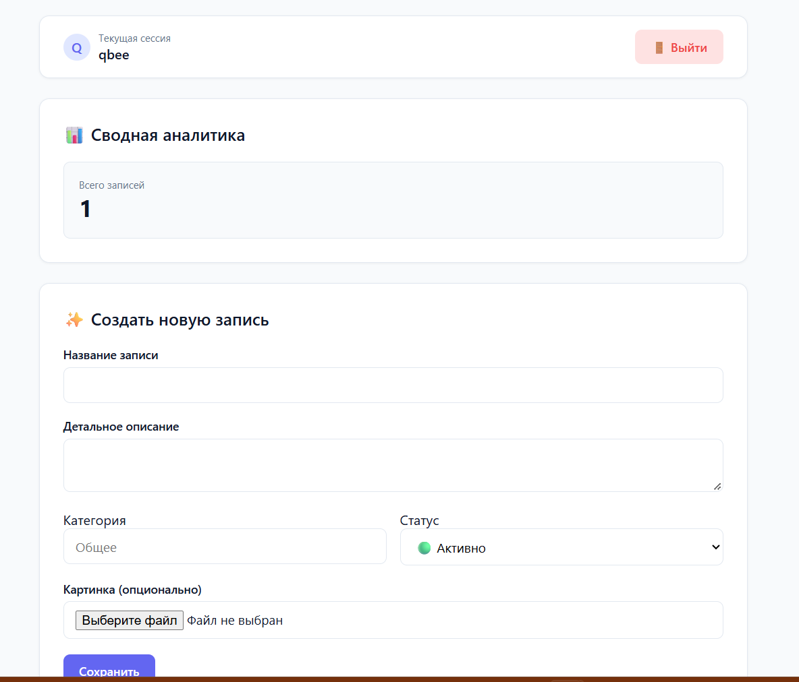
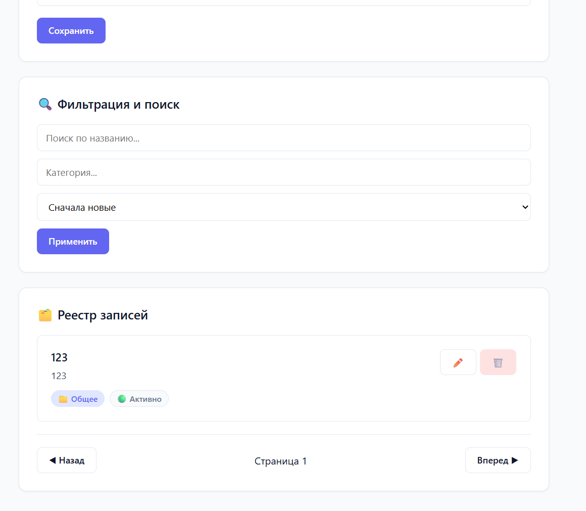

# Мини-блог (Учебная практика)

Студент: Саликова Лалита
Группа: ИСиП2-9-24
Вариант: Мини-блог (Посты и Комментарии)

## Описание
Веб-приложение на FastAPI с авторизацией через сессии. Пользователи могут регистрироваться, создавать посты, редактировать и удалять только свои записи.

## Установка и запуск
1. Клонировать репозиторий.
2. Создать и активировать виртуальное окружение: `python -m venv venv` -> `venv\Scripts\activate`
3. Установить зависимости: `pip install -r requirements.txt`
4. Применить миграции: `python -m alembic upgrade head`
5. Запустить сервер: `python -m uvicorn app.main:app --reload`

## Схема БД
* User: id, username, hashed_password.
* Post: id, title, content, created_at, is_published, views_count, category, status, image_url, owner_id.
* Comment: id, text, created_at, post_id, owner_id.

## Эндпоинты
* `POST /api/auth/register` — регистрация
* `POST /api/auth/login` — вход
* `GET /api/auth/me` — текущий пользователь
* `POST /api/auth/logout` — выход
* `GET /api/posts` — список постов (поиск, фильтр, пагинация)
* `POST /api/posts` — создание поста
* `GET /api/posts/{id}` — один пост
* `PATCH /api/posts/{id}` — редактирование
* `DELETE /api/posts/{id}` — удаление
* `POST /api/posts/{id}/comments` — добавить комментарий
* `GET /api/posts/stats` — статистика

## Скриншоты

